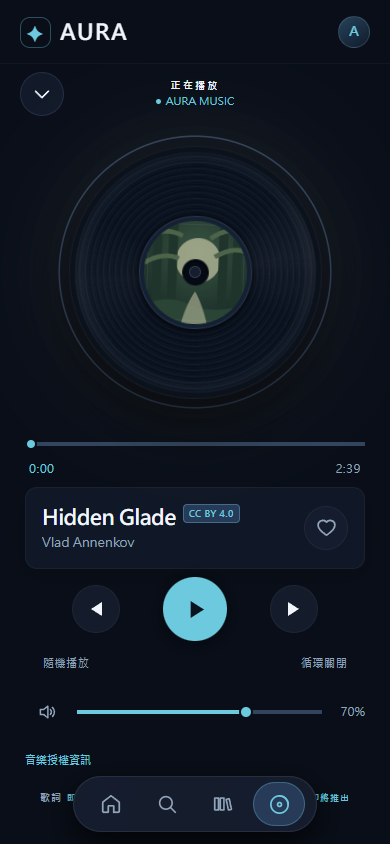
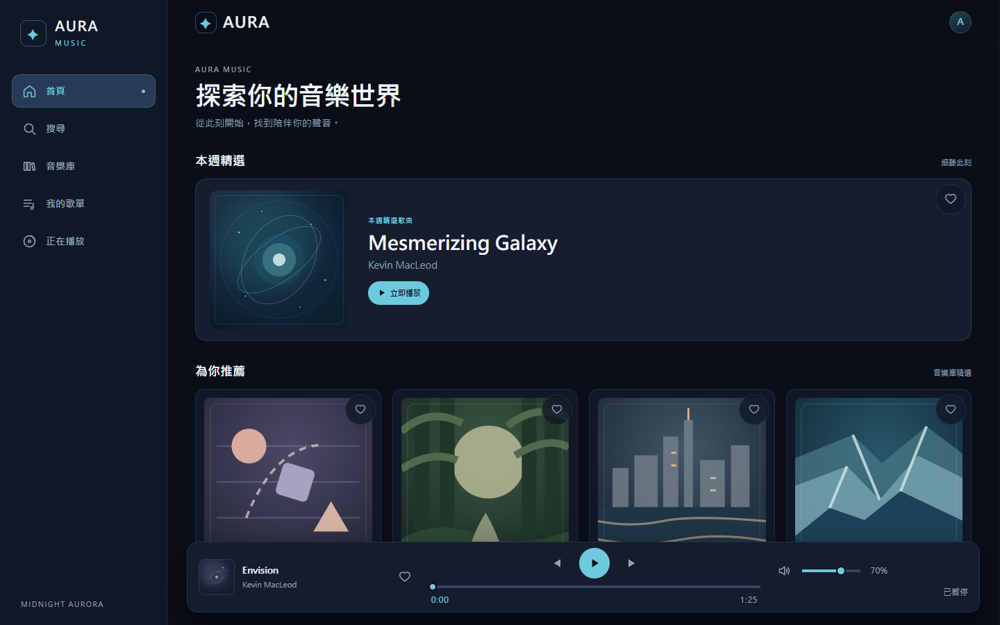

# AURA MUSIC

AURA MUSIC 是以 Vue 3 製作的繁體中文音樂播放器作品。介面保留 Stitch 參考設計的版型，採用「Midnight Aurora／午夜極光」深海藍、冰川青與月光白主題，提供 26 首具有明確授權的示範音樂。播放由單一瀏覽器 `HTMLAudioElement` 管理；進站時不會自動發聲。

**線上 Demo：** 待部署，網址將於人工驗收後補上。

## 畫面預覽

以下截圖取自 Midnight Aurora 的正式 Build preview。歌單畫面使用介面建立的範例歌單，歌曲均為專案中的授權音樂。

| 手機版（390 × 844） | 桌面版（1440 × 900） |
| --- | --- |
|  |  |

其他畫面：手機版 [首頁](docs/screenshots/home-mobile.png) · [音樂庫](docs/screenshots/library-mobile.png) · [搜尋](docs/screenshots/search-mobile.png) · [歌單列表](docs/screenshots/playlists-mobile.png) · [歌單詳情](docs/screenshots/playlist-detail-mobile.png)；桌面版 [音樂庫](docs/screenshots/library-desktop.png) · [正在播放](docs/screenshots/now-playing-desktop.png) · [歌單列表](docs/screenshots/playlists-desktop.png)。

## 技術架構

- Vue 3、TypeScript、Vite、Vue Router、Pinia
- Tailwind CSS 4（透過 `@tailwindcss/vite` 建置）與專案 CSS 設計樣式
- 原生 `HTMLAudioElement`、`localStorage`；無後端、帳號或商業音樂 API
- Vitest 單元測試；正式 Build 可使用既有 Playwright 工具進行瀏覽器驗證

## 核心功能

- 首頁精選、推薦、最近播放；音樂庫與即時搜尋歌曲名稱／歌手
- 收藏、歌手篩選與搜尋組合，收藏及最近播放儲存於本機
- 播放／暫停、Seek Bar、黑膠圓環、Mini Player、Shuffle、Repeat Off／All／One
- 桌面與手機音量控制、靜音及本機音量偏好保存
- 自訂歌單的建立、重新命名、刪除、歌曲加入／移除與拖曳／按鈕排序
- 從歌單播放時使用該歌單的佇列；跨頁共用同一個音訊引擎
- 正在播放頁的「音樂授權資訊」可查看目前歌曲署名、授權及官方來源

## 專案目錄

| 路徑 | 內容 |
| --- | --- |
| `src/views/`、`src/components/` | 首頁、音樂庫、搜尋、正在播放、歌單與共用 UI |
| `src/router/`、`src/stores/` | Vue Router、播放器與歌單的 Pinia 狀態 |
| `src/services/audio.ts`、`src/data/` | 單一音訊服務與曲目／本機資料工具 |
| `public/audio/`、`public/covers/` | 已授權 MP3 與自製 SVG 封面 |
| `tests/` | Vitest 測試 |
| `docs/AUDIO_LICENSES.md` | 每首歌曲的官方來源、下載位置、授權及雜湊 |
| `docs/screenshots/` | Midnight Aurora 正式 Build preview 的手機與桌面作品截圖 |
| `design-reference/` | 本機保留的原始 Stitch HTML 設計參考；含外部圖片連結，預設不納入公開版控 |

## 在本機執行

建議使用 Node.js 24；目前鎖定的 Vite 8 要求 Node.js `^20.19.0 || >=22.12.0`。使用專案根目錄的 `package-lock.json` 安裝。

```powershell
npm.cmd ci
npm.cmd run dev
```

```powershell
npm.cmd run build
npm.cmd run test
npm.cmd run preview
```

開發與預覽伺服器會在終端顯示本機網址。主要路由為 `/`、`/library`、`/search`、`/now-playing`、`/playlists`、`/playlists/:id`。

## Vercel 發布設定

匯入公開 Repository 時，以專案根目錄為 Root Directory、`npm run build` 為 Build Command、`dist` 為 Output Directory；Node.js 選 24.x。`vercel.json` 僅將現有 Vue Router 頁面回退至 `index.html`，不改寫 `/audio/`、`/covers/` 等靜態資源。Vite 會將 `public/` 內容複製到 `dist/` 根目錄。本階段尚未實際部署，正式網域的深層連結、CDN Range 回應及流量仍須於部署後複查。

## 音樂與素材授權

26 首音樂分別由 Kevin MacLeod、1000 Handz、Vlad Annenkov、Ketsa 創作。各曲來源頁與官方音檔均標示 [CC BY 4.0](https://creativecommons.org/licenses/by/4.0/)；請於公開再散布時保留作者、曲名、來源、授權連結與修改說明。完整逐曲官方連結、本地檔案與 SHA-256 見 [音樂授權文件](docs/AUDIO_LICENSES.md)。App 的正在播放頁亦提供目前歌曲的「音樂授權資訊」入口。署名不代表作者推薦或贊助本專案。

Kevin MacLeod 的曲目取自 [Incompetech](https://incompetech.com/music/royalty-free/)；1000 Handz、Vlad Annenkov 與 Ketsa 的曲目取自 [Free Music Archive](https://freemusicarchive.org/)。1000 Handz 的來源頁另提示 [1000Handz.com](https://1000handz.com/)，Ketsa 的來源頁另提示 [Ketsa.uk](https://ketsa.uk/)。音檔未剪輯或重新編碼；封面均為本專案自製抽象 SVG，不使用商業專輯圖片。

26 首音檔總計 **138,193,866 bytes（約 131.79 MiB）**，其中本次新增 18 首 **86.32 MiB**。同站 /audio/ 路徑需要將音檔納入 Repository 與靜態部署輸出；訪客播放會消耗相應頻寬。正式發布前應確認 Git 託管和部署方案的儲存、建置輸出及傳輸配額。

## 目前限制與後續方向

- 音樂庫固定為 26 首已授權示範歌曲，沒有串流服務、帳號、雲端同步或個人化推薦演算法。
- 收藏、最近播放與歌單只保存在目前瀏覽器的 `localStorage`；清除網站資料後會消失。
- 歌單播放佇列是開始播放當下的順序快照。排序、移除或刪除歌單不會改動已在播放的佇列；重新從歌單播放才會取得新順序。首頁、搜尋與音樂庫選歌會使用完整音樂庫佇列。重新整理後佇列回到音樂庫。
- 歌詞、接下來播放的完整編輯介面尚未開發；未來可擴充曲庫與跨裝置同步，但不在本次發布準備範圍。
